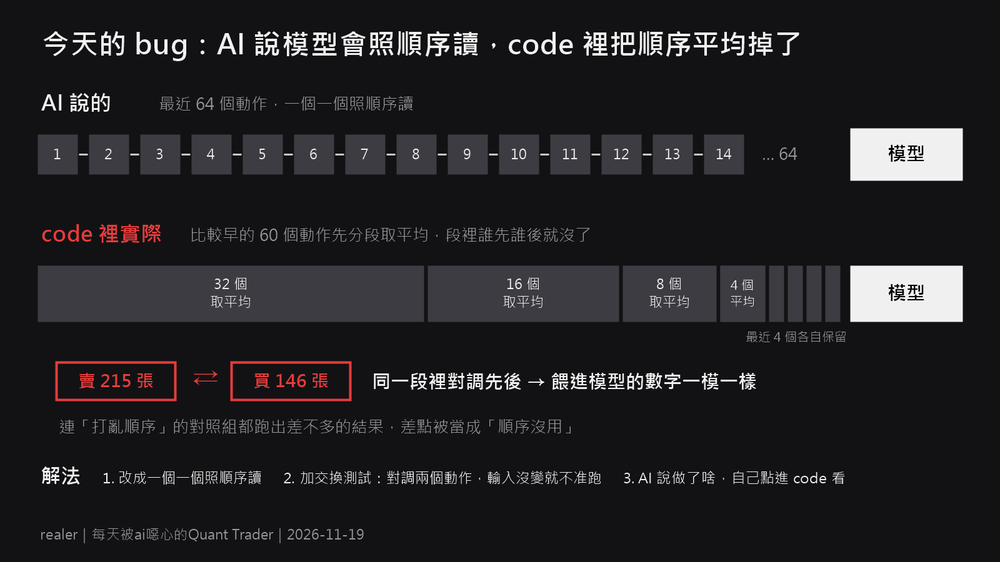

# 2026-11-19 AI 說模型會照順序讀，code 裡把順序平均掉了

## 背景

我在研究台股盤中的一種盤面：一筆大賣單砸下去，把買一吃光，接著買方馬上主動反擊。我想知道模型看不看得出「誰先打、對方怎麼回」。

所以這一版我叫 AI 改設計：不要再餵事先算好的摘要欄，改成把逐筆成交和五檔切成一個一個「動作」，讓模型照順序讀最近 64 個動作。

## bug

AI 跑完回報：「模型看 64 個動作」。

但我把 code 叫出來自己看（同時也丟給另一個 AI 去 GitHub 對 code），發現實際寫的是：

- 最近 4 個動作各自保留
- 再往前的 60 個，分成 4、8、16、32 個一段，每段**取平均**

平均完，段裡面誰先誰後就沒了。拿我截圖裡那兩筆來試：「賣 215 張」跟「買 146 張」如果落在同一段，對調先後，餵進模型的數字**一模一樣**。

更麻煩的是，這一版本來就有一組「把順序打亂」的對照。結果正常順序跟打亂順序跑出來差不多，差一點就被我解讀成「順序沒用」。其實是兩組模型本來就都看不到順序。

## 為什麼會這樣

寫 code 的 AI 為了把參數壓小，用了「近的看細、遠的看粗」這個常見做法，它在凍結定義裡也只寫了一句「等價段內權重共享」。這做法本身不算錯，但剛好跟這一版的目的衝突。

負責下規格的 AI 只寫了「小型序列網路」，沒寫「每個動作的先後一定要保留」；寫 code 的交回來之後，它也沒讀就跟我回報「模型看 64 個動作」。

## 我的解法

1. **改成一個一個照順序讀**：換成逐個讀 64 個動作的序列模型（GRU），不分段、不平均，參數量差不多。
2. **加交換測試，當成開跑前的關卡**：把兩個動作對調，舊的輸入完全不變、新的輸入和輸出都要變，不然不准跑。這個測試只證明接線對了，不證明模型有用。
3. **AI 說它做了啥，我自己點進 code 看那幾行**。AI 回報的是它以為自己做了什麼，不是 code 實際做了什麼。

## 一句話

AI 回報的是它以為自己做了啥，要看 code 才知道實際做了啥。
